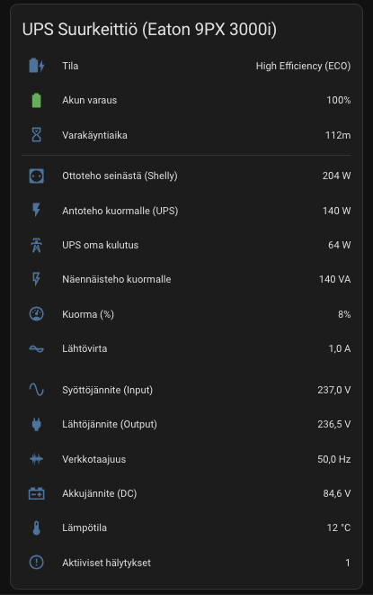

# Eaton 9PX Home Assistant SNMP Integration (High-Precision 0.1 V / 0.1 Hz)

High-precision Home Assistant SNMP package, Lovelace dashboard card, and safe shutdown automation for Eaton 9PX UPS units equipped with an Eaton Gigabit Network Card (Network-M2 / Network-M3).

Unlike standard UPS-MIB configurations that round voltages and frequencies to whole integers, this configuration combines **RFC1628 (UPS-MIB)** and **Eaton PowerChain MIB (`.534.10.2`)** OIDs to provide `0.1 V`, `0.1 Hz`, and `0.1 A` resolution, along with internal temperature and calculated UPS overhead/loss power.

## Tested Hardware & Firmware

This configuration has been verified against the following hardware and firmware stack:

* **UPS Model:** Eaton 9PX 3000i RT 3U (`9PX3000iRT3U`)
* **UPS Chassis Firmware:** `01.22.6523`
* **Network Card:** Eaton Gigabit Network Card (`Network-M2 or Network-M3`)
* **Network Card Firmware:** `3.1.15`

## Prerequisites

1. **Enable SNMPv1 on the Eaton Network Card:**
   * Log in to the UPS web interface (`https://<UPS_IP>`).
   * Navigate to **Settings** -> **Network** -> **SNMP**.
   * Enable **SNMPv1** and ensure the read-only community string is set to **`public`** (or update the `community:` field in the YAML sensors accordingly).
2. **Home Assistant Packages (Recommended):**
   * Ensure `packages: !include_dir_named packages` is enabled under `homeassistant:` in your `configuration.yaml`.
3. **Optional Smart Plug (for UPS Overhead Calculation):**
   * If you measure wall input power using a smart plug (e.g., Shelly), replace `sensor.ups_wall_plug_power` in `eaton_ups.yaml` with your plug's power entity ID. Otherwise, remove the `template:` section.

## Installation

1. Copy `eaton_ups.yaml` into your Home Assistant `config/packages/` directory.
2. Replace `192.168.1.100` with your UPS IP address.
3. Go to **Developer Tools -> YAML**, click **Check Configuration**, and reload **SNMP** and **Template Entities** (or restart Home Assistant).
4. Add a new **Manual** card to your Lovelace dashboard and paste the contents of `lovelace_card.yaml`.

## Dashboard Preview

*Example Lovelace card showing real-time `0.1 V` voltage precision, internal temperature, and calculated UPS overhead power (labels mainly in Finnish at this example, sorry for that).*
