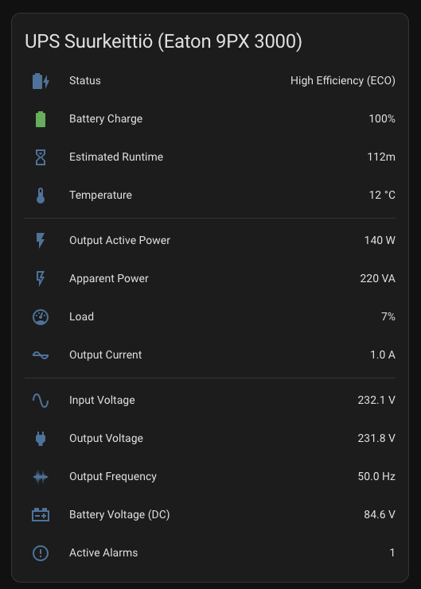

# Eaton 9PX UPS SNMP Package for Home Assistant

High-precision Home Assistant YAML package and Lovelace dashboard card for **Eaton 9PX** (and compatible Eaton Network-M2 / Network-M3) UPS units over SNMPv1.

Unlike standard RFC1628-only templates that truncate readings to whole integers, this configuration combines **Eaton PowerChain MIB**, **XUPS-MIB**, and **RFC1628** OIDs to expose **0.1 V**, **0.1 Hz**, and **0.1 A** decimal precision alongside operating mode decoding (including *High Efficiency / ECO*) and optional UPS self-consumption (overhead) calculation.



## Features

- **0.1-unit resolution** for Input Voltage (`V`), Output Voltage (`V`), Battery DC Voltage (`V`), Output Frequency (`Hz`), and Output Current (`A`)
- **Full operating mode decoding** (`Normal (Online)`, `High Efficiency (ECO)`, `On Battery`, `Bypass`, `Booster`, `Reducer`, etc.)
- **Long-term statistics ready** (`state_class: measurement` and proper `device_class` on all numeric sensors)
- **Optional UPS overhead calculation**: subtracts UPS active output power (`W`) from an upstream smart plug's wall power (`W`) to show real-time inverter/rectifier self-consumption

## Prerequisites

1. **Enable SNMPv1 on your Eaton Network Card:**
   - Log in to the Eaton Network-M2 / Network-M3 web interface.
   - Navigate to **Network & Protocol → SNMP** (or *Settings → Network → SNMP*).
   - Enable **SNMPv1** and set a read-only community string (avoid keeping the default `public` if your firewall uses IDS/IPS, as Suricata-based systems such as UniFi IPS flag cross-subnet `public` SNMP traffic).
   - Ensure the network card has a valid **Default Gateway** configured if Home Assistant is on a different VLAN/subnet.

2. **Enable Home Assistant Packages:**
   In your `/config/configuration.yaml`, ensure `packages` is enabled under `homeassistant:`:
   ```yaml
   homeassistant:
     packages: !include_dir_named packages
   ```

## Installation

1. **Create the package file:**
   Create `/config/packages/eaton_9px_ups.yaml` (create the `/config/packages` directory first if it does not exist) and paste the contents of [`eaton_9px_ups.yaml`](eaton_9px_ups.yaml) into it.

2. **Configure UPS IP & SNMP Community:**
   Replace `192.168.1.100` with your Eaton network card's IP address and `public` with your SNMPv1 read-only community string across the sensor definitions.

3. **Configure or remove optional overhead sensor:**
   If you measure wall power upstream of the UPS with a smart plug (e.g., Shelly Plug), replace `sensor.ups_wall_plug_power` in the `template:` section with your smart plug's power sensor entity ID. Otherwise, remove the `template:` block at the bottom of the file.

4. **Validate & Restart Home Assistant:**
   - Go to **Developer Tools → YAML** and click **Check Configuration**.
   - Perform a full **Restart Home Assistant** (a simple YAML reload is not enough on initial setup because the legacy `snmp` platform requires a full restart to register new entities).

5. **Add the Lovelace Dashboard Card:**
   Open your dashboard, click **Edit Dashboard → + Add Card → Manual**, and paste the contents of [`eaton_9px_card.yaml`](eaton_9px_card.yaml).

## Included Sensors & OID Reference

| Entity ID | Description | Unit | OID | MIB | Scaling |
| :--- | :--- | :---: | :--- | :--- | :---: |
| `sensor.eaton_9px_status` | Operating Mode | — | `1.3.6.1.4.1.534.1.4.5.0` | XUPS-MIB | Value map |
| `sensor.eaton_9px_battery_soc` | Battery State of Charge | `%` | `1.3.6.1.2.1.33.1.2.4.0` | RFC1628 | `1:1` |
| `sensor.eaton_9px_runtime_remaining` | Estimated Runtime Remaining | `min` | `1.3.6.1.2.1.33.1.2.3.0` | RFC1628 | `1:1` |
| `sensor.eaton_9px_output_power` | Output Active Power | `W` | `1.3.6.1.2.1.33.1.4.4.1.4.1` | RFC1628 | `1:1` |
| `sensor.eaton_9px_apparent_power` | Output Apparent Power | `VA` | `1.3.6.1.4.1.534.1.4.4.1.4.1` | XUPS-MIB | `1:1` |
| `sensor.eaton_9px_load_percentage` | Output Load Percentage | `%` | `1.3.6.1.2.1.33.1.4.4.1.5.1` | RFC1628 | `1:1` |
| `sensor.eaton_9px_input_voltage` | Input Voltage | `V` | `1.3.6.1.4.1.534.10.2.2.2.1.2.1` | PowerChain | `÷ 10` |
| `sensor.eaton_9px_output_voltage` | Output Voltage | `V` | `1.3.6.1.4.1.534.10.2.2.3.1.0` | PowerChain | `÷ 10` |
| `sensor.eaton_9px_battery_voltage` | Battery DC Voltage | `V` | `1.3.6.1.2.1.33.1.2.5.0` | RFC1628 | `÷ 10` |
| `sensor.eaton_9px_frequency` | Output Frequency | `Hz` | `1.3.6.1.2.1.33.1.4.2.0` | RFC1628 | `÷ 10` |
| `sensor.eaton_9px_output_current` | Output Current | `A` | `1.3.6.1.2.1.33.1.4.4.1.3.1` | RFC1628 | `÷ 10` |
| `sensor.eaton_9px_temperature` | UPS / Ambient Temperature | `°C` | `1.3.6.1.4.1.534.1.6.1.0` | XUPS-MIB | `1:1` |
| `sensor.eaton_9px_alarms` | Active Alarms Count | — | `1.3.6.1.4.1.534.1.7.1.0` | XUPS-MIB | `1:1` |
| `sensor.eaton_9px_own_consumption` | UPS Overhead / Self-Consumption *(optional)* | `W` | *Template sensor* | — | `Wall - Output` |

### Status Value Mapping (`sensor.eaton_9px_status`)

| Raw Value | Decoded State | Raw Value | Decoded State |
| :---: | :--- | :---: | :--- |
| `1` | `Other` | `6` | `Booster` |
| `2` | `None` | `7` | `Reducer` |
| `3` | `Normal (Online)` | `8` | `Parallel Capacity` |
| `4` | `Bypass` | `9` | `Parallel Redundant` |
| `5` | `On Battery` | `10` | `High Efficiency (ECO)` |

## Troubleshooting

- **Sensors show `unknown` or fail to register across VLANs / VPNs:**
  - Verify **UDP port 161** is allowed from your Home Assistant host to the UPS IP (and return traffic is permitted).
  - If using **UniFi OS / Suricata IDS/IPS**, cross-subnet SNMP queries using the default `public` community string trigger signature `GPL SNMP public access udp (SID 2101411)` and get silently dropped. Use a custom community string (e.g., `eaton_mon`) on both the UPS and in YAML.
  - Ensure **SNMPv1** (not only SNMPv3) is enabled on the Eaton network card, as Home Assistant's YAML `snmp` sensor defaults to SNMPv1.
- **Input/Output voltage reads `0.0 V` on older firmware:**
  - Some older Eaton NMC firmware revisions do not expose the PowerChain `0.1 V` OIDs (`1.3.6.1.4.1.534.10.*`). If your unit returns `0.0 V`, switch `input_voltage` to `1.3.6.1.2.1.33.1.3.3.1.3.1` and `output_voltage` to `1.3.6.1.2.1.33.1.4.4.1.2.1` (integer `1 V` resolution) and remove `/ 10` from their `value_template`.

## License

MIT
